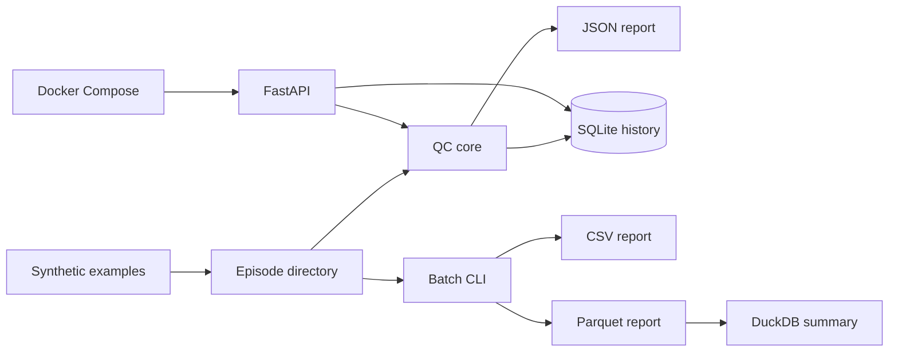

# fr3-episode-qc

[](https://github.com/TJchao/FR3-Episode-Qc/actions/workflows/ci.yml)

Lightweight episode quality checks for FR3 robot-learning data.

This project turns the episode QC workflow used in a Franka Research3 grasping project into a small, reproducible CLI and HTTP service. It checks field completeness, temporal consistency, action/state dimensions, camera latency, RGB/Depth frame consistency, and stores each QC result in SQLite.

The original robot dataset is not included. It contains lab data and is not approved for publication. This repository uses deterministic synthetic episodes that exercise every QC rule.

## Scope

Included:

- Episode QC CLI and FastAPI service
- SQLite QC history with `status` and `dataset_version` filtering
- Batch QC reports in CSV and Parquet, plus DuckDB summaries
- Docker Compose deployment and GitHub Actions CI

Not included:

- Real robot data
- Distributed data processing
- Production-grade lineage or data versioning
- Message queues, Kubernetes, or a multi-node data platform

## Data Schema

Each episode is a directory containing:

```text
episode/
  frames.npz
  metadata.json
```

`frames.npz` fields:

| Field | Shape | Description |
| --- | --- | --- |
| `timestamp_s` | `(N,)` | Episode timestamps in seconds |
| `robot_time_ns` | `(N,)` | Robot-side timestamps in nanoseconds |
| `camera_time_ns` | `(N,)` | Camera timestamps in nanoseconds |
| `camera_age_ms` | `(N,)` | Camera frame age at policy/control time |
| `state` | `(N, 8)` | Robot state used by the policy |
| `action` | `(N, 7)` | Robot action command |

Required `metadata.json` fields:

```json
{
  "episode_id": "ep_valid",
  "frame_count": 128,
  "fps": 10,
  "state_dim": 8,
  "action_dim": 7,
  "rgb_frame_count": 128,
  "depth_frame_count": 128,
  "schema_version": "fr3-episode-v1"
}
```

## QC Rules

An episode fails when any of the following is true:

- `frames.npz` or `metadata.json` is missing
- A required NPZ or metadata field is missing
- Required fields have different first-dimension lengths
- `robot_time_ns` or `timestamp_s` is not strictly increasing
- Any numeric field contains NaN or Inf
- `state` is not `(N, 8)`
- `action` is not `(N, 7)`
- `camera_age_ms` P95 is 50 ms or higher
- `metadata.frame_count` does not match the actual frame count
- `rgb_frame_count` or `depth_frame_count` does not match the actual frame count
- Metadata dimensions or schema version do not match the expected schema

The report includes:

```json
{
  "episode_id": "ep_valid",
  "status": "passed",
  "errors": [],
  "warnings": [],
  "frame_count": 128,
  "camera_age_p95_ms": 31.917,
  "episode_hash": "sha256:..."
}
```

`episode_hash` is a combined SHA-256 hash of `frames.npz` and `metadata.json`, allowing the same episode content to be recognized across QC runs.

## Architecture



## Data Synchronization Mechanism

Robot-learning episodes are normalized after several upstream streams are recorded. Camera, robot state, operator input, and the data recorder can run at different rates, so the useful episode boundary is not each producer's native rate; it is the aligned observation-action stream used by training and deployment.

This project focuses on validating that normalized stream:

- `timestamp_s` and `robot_time_ns` must be strictly increasing, exposing dropped, duplicated, or incorrectly ordered records.
- `camera_age_ms` measures how old the selected camera observation is at the policy/control time. Its P95 must stay below the configured threshold, which catches stale images without requiring every camera frame to arrive at exactly the same time as the robot state.
- RGB and Depth frame counts must match the episode frame count, catching partial writes or camera pipeline failures.
- State and action dimensions must match the configured schema, preventing silent train/deploy interface changes.

The synthetic examples use a small 10 Hz normalized episode stream for demonstration. The camera-age threshold and schema dimensions are shared between data generation and validation, so test data and QC rules cannot drift apart.

## Local Setup

```bash
python -m venv .venv

# Linux/macOS
source .venv/bin/activate

# Windows PowerShell
.venv\Scripts\Activate.ps1

pip install -r requirements.txt
```

Generate synthetic examples:

```bash
python scripts/make_examples.py
```

## CLI

```bash
python -m app.qc examples/ep_valid
python -m app.qc examples/ep_camera_age_p95
```

The command prints a JSON report. It exits with code `0` when the episode passes and `1` when it fails, so it can be used in a shell pipeline.

To restrict episode paths to a specific root:

```bash
python -m app.qc examples/ep_valid --allowed-root examples
```

Check every episode under a directory and write CSV and Parquet reports:

```bash
python -m app.qc_batch examples \
  --csv-output reports/qc_results.csv \
  --parquet-output reports/qc_results.parquet \
  --dataset-version synthetic-v1 \
  --git-commit "$(git rev-parse --short HEAD)"
```

The batch command prints the number of checked, passed, and failed episodes plus a structured count of each error type. Add `--fail-on-error` when it is used as a pipeline gate.

Summarize the Parquet report with DuckDB:

```bash
python -m app.stats reports/qc_results.parquet
```

The summary includes status counts, error-type counts, camera-age statistics by status, and dataset-version counts.

## API

Start the development server:

```bash
uvicorn app.main:app --reload
```

Interactive documentation is available at:

```text
http://127.0.0.1:8000/docs
```

Check one episode:

```bash
curl -X POST http://127.0.0.1:8000/qc \
  -H "Content-Type: application/json" \
  -d "{\"episode_path\": \"examples/ep_valid\"}"
```

Read recent QC runs:

```bash
curl http://127.0.0.1:8000/runs
```

Filter runs by status or dataset version:

```bash
curl "http://127.0.0.1:8000/runs?status=failed"
curl "http://127.0.0.1:8000/runs?dataset_version=synthetic-v1"
curl "http://127.0.0.1:8000/runs?status=failed&dataset_version=synthetic-v1"
```

Read one run:

```bash
curl http://127.0.0.1:8000/runs/1
```

The service restricts episode access to `QC_ALLOWED_ROOT` when that environment variable is set. It uses `QC_DB_PATH` for the SQLite database when provided.

## Docker

```bash
docker compose up --build
```

The service then listens on:

```text
http://127.0.0.1:8000
```

In Docker Compose, synthetic episodes are mounted read-only at `/data`, and SQLite history is persisted in a named volume.

Example request inside Docker:

```bash
curl -X POST http://127.0.0.1:8000/qc \
  -H "Content-Type: application/json" \
  -d "{\"episode_path\": \"/data/ep_valid\"}"
```

## Tests

```bash
pytest
```

The tests cover:

- The valid synthetic episode
- Each isolated invalid episode
- Batch QC, structured error classification, CSV, and Parquet outputs
- DuckDB summaries over generated Parquet reports
- Path-root restrictions
- API health and QC endpoints
- API filtering by status and dataset version
- Request validation and HTTP error codes
- SQLite history insertion and lookup

GitHub Actions runs the Python tests and builds the Docker image on every push and pull request.

## Design Notes

- The QC threshold and dimensions are shared between data generation and validation, avoiding drift between test data and checks.
- Paths are resolved before access and constrained to an allowed root.
- NPZ loading disables pickle for safety.
- SQLite is intentionally minimal; it records report history without introducing an ORM or a separate service.
- SQLite is suitable for this single-service, small-batch laboratory workflow. Under many concurrent writers, its database-level write lock can become a bottleneck; a production multi-worker deployment would use PostgreSQL or another external database service.
- Parquet and DuckDB provide a small, local analytics path without introducing a distributed processing framework.
- The repository is a small engineering demonstration, not a claim of large-scale robot-data infrastructure.

## License

This project is released under the [MIT License](LICENSE).
